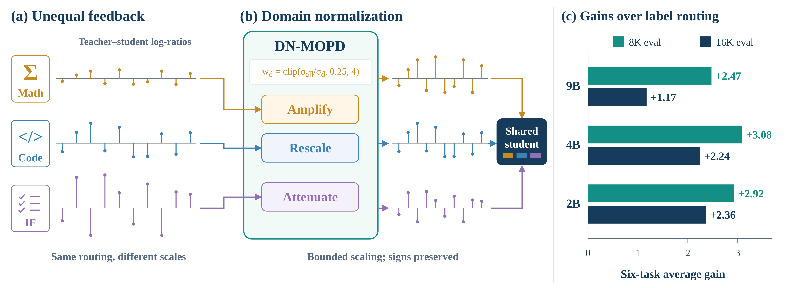

<div align="center">

# DN-MOPD: Domain-Normalized Multi-Teacher On-Policy Distillation

[](https://arxiv.org/abs/2609.35347)
[](https://lixin.ai/DN-MOPD)
[](https://huggingface.co/collections/XINLI1997/dn-mopd-6aba5f0df7bd8732d7205ed4)
[](https://huggingface.co/datasets/XINLI1997/DN-MOPD-Data)
[](LICENSE)

[Xin Li](https://lixin.ai/)¹, Hao Jiang¹, [Xin Gao](https://gaoxin492.github.io/)², Annan Wang¹, Yuchen Xie¹, Jinghao Guo¹, Xingwei Qu³, Yichi Zhang,
[Chau Yuen](https://blogs.ntu.edu.sg/chau-yuen/)¹

¹ Nanyang Technological University · ² Yale University · ³ University of Manchester

</div>

**DN-MOPD merges several specialist LLMs (math, code, instruction following) into one student model by on-policy
distillation, and rescales each specialist's feedback so that no single domain dominates training.**

<p align="center">
  
</p>

<p align="center"><sub>
(a) Each domain's teacher gives token-level feedback of a very different size (schematic).
(b) DN-MOPD rescales each domain's feedback to a common size and keeps its sign (schematic).
(c) Gain in the six-benchmark average over standard multi-teacher distillation (MOPD), at three model sizes and two
answer-length limits.
</sub></p>

## Highlights

- **The problem.** In multi-teacher on-policy distillation (MOPD), each prompt is scored by the teacher of its
  domain. That fixes *which* teacher teaches, but not *how strongly* its feedback counts. Instruction-following (IF)
  feedback is several times more spread out than math feedback, so it dominates the student's updates.
- **The fix is one line.** In each batch, scale domain *d*'s feedback by `w_d = clip(σ_all / σ_d, 0.25, 4)`, where σ
  is the spread (standard deviation) of the teacher–student log-ratios. No extra teacher calls, models or routers.
- **Better than MOPD at every size.** On Qwen3.5-9B, 4B and 2B, the six-benchmark average rises by +1.17 to +2.36
  points (16K-token answers) and +2.47 to +3.08 points (8K). Every 95% interval is above zero, and the gains hold
  over three random seeds.
- **Math gains the most.** Most of the gain comes from turning IF feedback down, not from turning math feedback up.
- **Fully open.** 21 checkpoints, the training prompts and the per-question evaluation records. One command
  recomputes every Qwen3.5 number in the paper on a CPU.

### Main results

Six-benchmark average (%), 16K-token answer limit, student seed 42.

| Method | Qwen3.5-9B | Qwen3.5-4B | Qwen3.5-2B |
|---|:---:|:---:|:---:|
| Initial model | 57.1 | 47.7 | 24.0 |
| Best single-teacher student | 58.5 | 50.9 | 28.8 |
| MOPD (label routing) | 58.4 | 50.3 | 26.6 |
| **DN-MOPD (ours)** | **59.6** | **52.5** | **29.0** |
| Gain over MOPD | +1.17<br><sub>[+0.28, +2.03]</sub> | +2.24<br><sub>[+1.30, +3.20]</sub> | +2.36<br><sub>[+1.58, +3.17]</sub> |

- **Benchmarks:** AIME 2025/2026 (math), LiveCodeBench v5/v6 (code), IFEval/IFBench (instruction following).
- **Rows:** "Best single-teacher student" learns from the code teacher only, the strongest of the three at every
  size. "Label routing" means each prompt is scored by its own domain's teacher. Brackets are 95% intervals.
- **Limits:** DN-MOPD's lead over the best single-teacher student is smaller than its lead over MOPD, and some of
  those intervals include zero. Offline distillation (SeqKD-SFT) and task-arithmetic merging score higher under their
  own training recipes. The full 9B table is [below](#full-9b-results).

## Quick start

### 1. Install

This is the paper's evaluation environment (Python 3.10, vLLM 0.18.0, PyTorch 2.10, pinned versions):

```bash
git clone https://github.com/LiXin97/DN-MOPD.git && cd DN-MOPD
conda create -y -n dnmopd-eval python=3.10 && conda activate dnmopd-eval
pip install -r env/requirements-eval.txt -c env/constraints-eval.txt
pip install --no-deps -e .    # the dn_mopd package (it needs only PyTorch)
```

### 2. Download a model

```bash
# the 2B DN-MOPD student, about 4.4 GB, into the Hugging Face cache
hf download XINLI1997/DN-MOPD-Qwen3.5-2B
```

<details>
<summary>All 21 released checkpoints (DN-MOPD students, MOPD baselines, specialist teachers)</summary>

| Model | Qwen3.5-9B | Qwen3.5-4B | Qwen3.5-2B |
|---|:---:|:---:|:---:|
| DN-MOPD student | [🤗 9B](https://huggingface.co/XINLI1997/DN-MOPD-Qwen3.5-9B) | [🤗 4B](https://huggingface.co/XINLI1997/DN-MOPD-Qwen3.5-4B) | [🤗 2B](https://huggingface.co/XINLI1997/DN-MOPD-Qwen3.5-2B) |
| MOPD baseline (label routing) | [🤗 9B](https://huggingface.co/XINLI1997/DN-MOPD-Qwen3.5-9B-baseline-label) | [🤗 4B](https://huggingface.co/XINLI1997/DN-MOPD-Qwen3.5-4B-baseline-label) | [🤗 2B](https://huggingface.co/XINLI1997/DN-MOPD-Qwen3.5-2B-baseline-label) |
| Math teacher (GRPO) | [🤗 9B](https://huggingface.co/XINLI1997/DN-MOPD-Qwen3.5-9B-teacher-math) | [🤗 4B](https://huggingface.co/XINLI1997/DN-MOPD-Qwen3.5-4B-teacher-math) | [🤗 2B](https://huggingface.co/XINLI1997/DN-MOPD-Qwen3.5-2B-teacher-math) |
| Code teacher (GRPO) | [🤗 9B](https://huggingface.co/XINLI1997/DN-MOPD-Qwen3.5-9B-teacher-code) | [🤗 4B](https://huggingface.co/XINLI1997/DN-MOPD-Qwen3.5-4B-teacher-code) | [🤗 2B](https://huggingface.co/XINLI1997/DN-MOPD-Qwen3.5-2B-teacher-code) |
| IF teacher (GRPO) | [🤗 9B](https://huggingface.co/XINLI1997/DN-MOPD-Qwen3.5-9B-teacher-if) | [🤗 4B](https://huggingface.co/XINLI1997/DN-MOPD-Qwen3.5-4B-teacher-if) | [🤗 2B](https://huggingface.co/XINLI1997/DN-MOPD-Qwen3.5-2B-teacher-if) |
| DN-MOPD, trained twice as long | [🤗 9B](https://huggingface.co/XINLI1997/DN-MOPD-Qwen3.5-9B-160updates) | [🤗 4B](https://huggingface.co/XINLI1997/DN-MOPD-Qwen3.5-4B-160updates) | [🤗 2B](https://huggingface.co/XINLI1997/DN-MOPD-Qwen3.5-2B-160updates) |
| MOPD baseline, trained twice as long | [🤗 9B](https://huggingface.co/XINLI1997/DN-MOPD-Qwen3.5-9B-baseline-label-160updates) | [🤗 4B](https://huggingface.co/XINLI1997/DN-MOPD-Qwen3.5-4B-baseline-label-160updates) | [🤗 2B](https://huggingface.co/XINLI1997/DN-MOPD-Qwen3.5-2B-baseline-label-160updates) |

- Students use 80 updates; "twice as long" means 160 updates. Only the seed-42 students are released.
- The weights are bfloat16 exports of the base Qwen3.5 architecture, with the base model's tokenizer and chat template.
  Transformers needs version 5 or later. Each model card has a Transformers example.
- The exports leave out the base model's multi-token-prediction (`mtp.*`) weights, so MTP speculative decoding is not
  available. Normal decoding is unaffected.
- [hf/MANIFEST.md](hf/MANIFEST.md) links every checkpoint to its evaluation records.

</details>

### 3. Run a minimal example

**Chat with the model (one GPU).** The models were trained and evaluated in non-thinking mode, so turn thinking off:

```python
from vllm import LLM, SamplingParams

llm = LLM(model="XINLI1997/DN-MOPD-Qwen3.5-2B", max_model_len=32768)
params = SamplingParams(temperature=1.0, top_p=1.0, max_tokens=16384)
question = "Find the sum of all positive divisors of 36. Put the final answer in \\boxed{}."
outputs = llm.chat([{"role": "user", "content": question}], params,
                   chat_template_kwargs={"enable_thinking": False})
print(outputs[0].outputs[0].text)
```

**Add DN-MOPD to your own trainer (CPU, a few seconds).** DN-MOPD sits between teacher scoring and the usual clipped
on-policy distillation loss:

```python
import torch
from dn_mopd import (DomainNormalizer, reverse_kl_advantages,
                     scale_advantages_batched, clipped_opd_loss_batched)

torch.manual_seed(0)
# A toy rollout batch: 6 responses x 16 tokens, two per domain (0 = math, 1 = code, 2 = IF).
domain_ids = torch.tensor([0, 0, 1, 1, 2, 2])
mask = torch.ones(6, 16)
# Teacher log-probs of the sampled tokens, and the student's log-probs saved at sampling
# time. The IF feedback is the most spread out.
teacher_logp = -torch.rand(6, 16)
spread = torch.tensor([0.5, 0.5, 1.0, 1.0, 2.0, 2.0])[:, None]
rollout_logp = teacher_logp + spread * torch.randn(6, 16)
new_logp = rollout_logp.clone().requires_grad_()  # current student log-probs (with grad)

normalizer = DomainNormalizer(["math", "code", "if"])
# 1) one multiplier per domain: w_d = clip(sigma_all / sigma_d, 0.25, 4)
weights, _ = normalizer.multipliers_batched(teacher_logp - rollout_logp, mask, domain_ids)
# 2) scale each token's advantage (teacher minus student log-prob) by its domain's w_d
adv = scale_advantages_batched(reverse_kl_advantages(teacher_logp, rollout_logp, mask),
                               domain_ids, weights)
# 3) the usual clipped on-policy distillation loss, unchanged
loss = clipped_opd_loss_batched(new_logp, rollout_logp, adv, mask)
loss.backward()

print({d: round(w, 2) for d, w in zip(normalizer.domains, weights.tolist())})
# {'math': 2.14, 'code': 1.51, 'if': 0.65}: IF is turned down, math and code are turned up
```

[dn_mopd/README.md](dn_mopd/README.md) covers packed sequences, multi-GPU training (`sync=True`) and the paper's
control modes. `python -m dn_mopd.examples.toy_opd_loop` runs a complete toy training loop on a CPU.

## Reproduce the paper's results

From fastest to slowest: check the numbers, evaluate a model, retrain everything.

### Check every number (CPU, seconds)

The per-question evaluation records of all 80 evaluated models are in `reproduce/`. These commands need only Python 3
and numpy:

```bash
python reproduce/reproduce.py --no-bootstrap   # all scores (about 10 s)
python reproduce/reproduce.py                  # plus all 95% intervals (a few minutes)

# DN-MOPD vs. MOPD at 2B, per domain, with 95% intervals
python -m eval.compare q35_2b_s_mdnorm q35_2b_s_route --cap 16384
```

`reproduce.py` ends with `ALL MATCH` when every value agrees with the paper. Model keys such as `q35_2b_s_mdnorm`
(DN-MOPD) and `q35_2b_s_route` (MOPD) are listed in [reproduce/README.md](reproduce/README.md#model-keys).

### Set up the full environments

Training and evaluation need different `transformers` versions, so they use two environments. The evaluation
environment is the one from [Quick start](#1-install).

| Environment | Python | Key packages |
|---|---|---|
| Training | 3.12 | PyTorch 2.11 (CUDA 13.0), SGLang 0.5.15.post1, transformers 5.12.1 |
| Evaluation | 3.10 | vLLM 0.18.0, transformers 4.57.6 |

```bash
# training environment
conda create -y -n dnmopd-train python=3.12 && conda activate dnmopd-train
pip install --index-url https://download.pytorch.org/whl/cu130 \
    torch==2.11.0 torchvision==0.26.0 torchaudio==2.11.0
pip install -r env/requirements-train.txt -c env/constraints-train.txt
pip install --no-deps -e ./miles -e .
python env/check_env.py --env train

# evaluation environment: from Quick start, plus the official checkers
conda activate dnmopd-eval
python -m eval.external.fetch       # LiveCodeBench / IFEval / IFBench checkers
python env/check_env.py --env eval
```

All versions are pinned to the paper's. [env/install.md](env/install.md) covers drivers, other GPUs and Docker.

### Evaluate a model

In the evaluation environment:

```bash
python -m eval.data.prepare    # download and verify the six benchmarks (once)

for s in aime25 aime26 lcb_v5 lcb_v6 ifeval ifbench; do
  python -m eval.generate --model XINLI1997/DN-MOPD-Qwen3.5-2B --name my_model \
      --suite $s --max-tokens 16384                              # generate answers (GPU)
  python -m eval.grade --gen outputs/eval/my_model/$s/cap16384   # grade them (CPU)
done

python -m eval.aggregate --records outputs/eval --cap 16384      # scores and average
# paired comparison with the paper's 2B MOPD model
python -m eval.compare my_model q35_2b_s_route --records-a outputs/eval --cap 16384
```

The settings match the paper: non-thinking mode, temperature 1.0, top-p 1.0, and 64 / 6 / 16 samples per question
for math / code / IF. [eval/README.md](eval/README.md) explains the protocol and multi-GPU sharding.

### Train teachers and students

Every run in the paper used **one node with 8 GPUs** (NVIDIA B200, 180 GB each). In the training environment:

```bash
python data/download.py              # training prompts from Hugging Face, about 1 GB
export MODEL_ROOT=/path/to/models    # holds Qwen3.5-2B/ (downloaded if missing)

for d in math code ifeval; do        # 1) one GRPO-trained teacher per domain
  bash recipes/qwen3.5/train_teacher_grpo.sh $d 2b
done
bash recipes/qwen3.5/train_student.sh label   2b 42   # 2) MOPD baseline, seed 42
bash recipes/qwen3.5/train_student.sh dn_mopd 2b 42   # 3) DN-MOPD, seed 42
```

- **Time on the paper's hardware:** a teacher takes 20–38 h; a student takes about 2.7 h (2B) to 4.5 h (9B).
- **Resuming:** rerun the same command after an interruption.
- **Other rows of the paper's tables:** `train_student.sh` takes other method names; see
  [recipes/qwen3.5/configs/methods.yaml](recipes/qwen3.5/configs/methods.yaml).
- **Safety:** the code teacher and the students run model-written programs in a local judge. It is not a sandbox, so
  use a machine you control.
- **Details:** [docs/recipe.md](docs/recipe.md) lists every hyperparameter, and [docs/hardware.md](docs/hardware.md)
  covers GPU memory and smaller GPUs.

### Full 9B results

<details>
<summary>Qwen3.5-9B on all six benchmarks (paper Table 1)</summary>

Scores (%), 16K-token answer limit, student seed 42. Math is avg@64, code avg@6 and IF avg@16. Average = mean of the
six benchmarks. Bold marks the best result among the multi-teacher methods. The 4B and 2B tables, the 8K results and
all intervals are in the paper and in `reproduce/`.

| Group | Method | AIME25 | AIME26 | LCB v5 | LCB v6 | IFEval | IFBench | Average |
|---|---|:---:|:---:|:---:|:---:|:---:|:---:|:---:|
|  | Initial model | 57.7 | 62.6 | 54.9 | 51.4 | 82.4 | 33.8 | 57.1 |
| Specialist teachers (RL) | Math teacher | 59.7 | 69.4 | 53.4 | 49.4 | 82.3 | 34.9 | 58.2 |
|  | Code teacher | 58.5 | 65.4 | 58.5 | 54.3 | 82.3 | 34.6 | 58.9 |
|  | IF teacher | 54.6 | 60.5 | 54.0 | 51.5 | 86.5 | 42.1 | 58.2 |
| Offline distillation | SeqKD-SFT | 61.3 | 67.6 | 62.7 | 56.0 | 86.0 | 42.4 | 62.6 |
| Parameter merging | ParamMerge-Avg | 59.4 | 68.3 | 54.0 | 50.9 | 84.1 | 36.4 | 58.9 |
|  | ParamMerge-TA | 59.1 | 68.6 | 55.2 | 50.9 | 86.1 | 43.3 | 60.5 |
| Single-teacher OPD | Math teacher | 58.9 | 69.5 | 53.7 | 49.4 | 82.4 | 34.7 | 58.1 |
|  | Code teacher | 58.3 | 66.2 | 57.0 | 52.6 | 82.6 | 34.2 | 58.5 |
|  | IF teacher | 56.8 | 61.9 | 52.1 | 49.2 | 84.7 | 38.9 | 57.3 |
| Multi-teacher OPD | Uniform pool | 57.1 | 65.9 | 53.6 | 52.3 | 83.3 | 35.7 | 58.0 |
|  | Dynamic router | 56.4 | 63.5 | 55.4 | 51.5 | 84.3 | 37.7 | 58.1 |
|  | MOPD (label routing) | 55.3 | 63.2 | **56.8** | **52.6** | 84.0 | 38.4 | 58.4 |
|  | **DN-MOPD (ours)** | **58.9** | **67.7** | 56.3 | 51.4 | **84.5** | **38.7** | **59.6** |

</details>

### Run the tests (CPU)

```bash
pip install -r env/requirements-dev.txt
make check TRAIN_PYTHON=/path/to/train-env/bin/python \
           EVAL_PYTHON=/path/to/eval-env/bin/python
```

## Repository structure

```text
DN-MOPD/
├── dn_mopd/          # the method as a small PyTorch package (works with any trainer)
├── miles/            # training framework (a fork of Uni-OPD / miles) with DN-MOPD built in
├── recipes/qwen3.5/  # one launch script per row of the paper's tables
├── eval/             # generation, grading, average scores and paired tests
├── reproduce/        # per-question evaluation records + reproduce.py
├── data/             # training-prompt download and rebuild scripts
├── env/              # pinned requirements, install guide, Dockerfiles
├── hf/               # model cards of the released checkpoints
├── docs/             # method, recipe, hardware, FAQ
├── patches/          # our changes to upstream Uni-OPD, as a patch
└── tests/            # CPU tests
```

More reading: [docs/method.md](docs/method.md) (the formulas and where they are in the code) and
[docs/faq.md](docs/faq.md).

## Citation

```bibtex
@article{li2026dnmopd,
  title   = {Beyond Teacher Assignment: Domain-Normalized Multi-Teacher On-Policy Distillation},
  author  = {Li, Xin and Jiang, Hao and Gao, Xin and Wang, Annan and Xie, Yuchen and Guo, Jinghao and Qu, Xingwei and Zhang, Yichi and Yuen, Chau},
  journal = {arXiv preprint arXiv:2609.35347},
  year    = {2026},
  url     = {https://arxiv.org/abs/2609.35347}
}
```

## License

- **Code:** [Apache 2.0](LICENSE). `miles/` is a modified fork of Uni-OPD / miles (Apache 2.0); see [NOTICE](NOTICE)
  and [patches/](patches/).
- **Evaluation records** in `reproduce/`: CC BY 4.0.
- **Model weights:** fine-tunes of Qwen3.5, under the same Apache 2.0 license.
- **Benchmarks and training data** keep their original licenses: see [data/DATA_LICENSES.md](data/DATA_LICENSES.md)
  and [reproduce/THIRD_PARTY.md](reproduce/THIRD_PARTY.md).

## Acknowledgements

We build on [Uni-OPD](https://github.com/WenjinHou/Uni-OPD), [miles](https://github.com/radixark/miles),
[SGLang](https://github.com/sgl-project/sglang), [vLLM](https://github.com/vllm-project/vllm),
[Math-Verify](https://github.com/huggingface/Math-Verify), the benchmarks
[LiveCodeBench](https://github.com/LiveCodeBench/LiveCodeBench),
[IFEval](https://github.com/google-research/google-research/tree/master/instruction_following_eval) and
[IFBench](https://github.com/allenai/IFBench), the training data
[DeepMath-103K](https://huggingface.co/datasets/zwhe99/DeepMath-103K) and
[Eurus-2-RL-Data](https://huggingface.co/datasets/PRIME-RL/Eurus-2-RL-Data), and the Qwen3.5 models.
